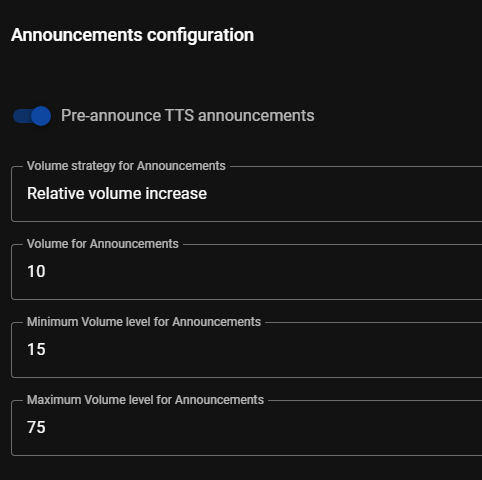

# Announcements

Announcements are either Text-to-Speech or audio files that are sent (from Home Assistant) to the MA players via the <a href="https://www.home-assistant.io/integrations/tts/" target="_blank" rel="noopener noreferrer">`tts.xxxxxx`</a> or [`music_assistant.play_announcement`](/faq/massannounce/) HA actions.

Only the [Home Assistant integration](/integration/installation/) is needed for this. The Home Assistant plugin and Home Assistant Media Players play no part in announcements.

> [!NOTE]
> The integration is not strictly required to send announcements as this can be done [via the UI](/usage/#the-queue)

## Overview

If music is being played by MA then this will be temporarily paused and restored after the announcement.

Players will be powered on before the announcement and then off again if it was not powered/active before the announcement.

Volume can be adjusted while playing the announcement.

If a player type has native support for announcements (such as Sonos, AirPlay, Snapcast and Sendspin) then that will be used in preference to the MA functionality providing an even smoother experience.

The functionality works with all players that are supported by Music Assistant.

Each player has settings which allow for adjustment of certain aspects of the announcement playback. Groups only have a setting for the pre-announcement sound. See also [Announcements Configuration](/settings/individual-player/#announcements-configuration)

The text is turned into speech by the default text-to-speech engine from [**Settings → AI**](/settings/ai/), unless the **Announcement text-to-speech engine** setting under [**Settings → Players → Playback**](/settings/playback/#announcements) picks another one for the whole server. The engines come from your plugins, and the [Home Assistant Plugin](/ha-plugin/#ai-and-text-to-speech-engines) makes every Home Assistant text-to-speech entity available.

## Native Support

If an announcement is sent to a single player that supports native announcements, the announcement will be handled by the player itself.

Native announcement support usually means that the player can "overlay" the announcement on top of any music that is playing. It will "duck" the volume of the music (or silence it completely), play the announcement with a volume boost and then revert the music volume. Music keeps playing and the entire announcement will be handled by the player itself.

Player types that support native announcements include Sonos S2 speakers, AirPlay speakers (also with **Sendspin (over AirPlay)** as their preferred output protocol) and ESPHome-based Sendspin devices. ESPHome-based Sendspin devices must also be added to Home Assistant, and Music Assistant must be connected to Home Assistant.

## MA Player Support

If a player does not support native announcements, MA will take care of it by stopping any playing music, adjust the volume (as configured), play the announcement, and then restore the previous state.

> [!NOTE]
> The MA announcement feature will ONLY work reliably if the player reports the state (e.g. playing, paused, idle) and the progress report (elapsed time) correctly. If any of those are not updated correctly then announcements will work poorly.

ESPHome can be unreliable with state updates so issues may occur with this player type. The same applies to some HA media players. Future updates of those platforms should improve performance.

## Group Behaviour

If an announcement is sent to a native Google Cast Group, Sync Group or a Universal Group, the announcement will always be played to ALL child players. The preference to (not) use a pre-announcement sound is defined on the group player in this case. The volume setting of the announcement is defined per player. If one of the child players was already playing, playback will be interrupted and NOT resumed. Bear that in mind with automations and target announcements to the individual players or just restart individual player playback if/when needed. Google Cast groups should play the announcement in sync.

If an announcement is sent to a single player, it plays on that player only, also when that player is grouped with others or leads a group. To play an announcement on all players of a group, send it to the group player (a Sync Group, Universal Group or Google Cast Group).

If an announcement is sent to a Sync Group (temporary or permanent) of which ALL child players support native announcements, the native functionality will be used to playback the announcement and MA will ensure the announcement is started at (more or less) the same time so all players should play the announcement in sync.

If an announcement is sent to a player that is grouped with others (and does not support native announcements), it is temporarily taken out of the group, or its members are taken off it when it leads the group. The announcement is played and the group is restored afterwards.

In all cases the playback should resume after the announcement.

> [!NOTE]
> If the announcement is sent to one player of a group, the playback needs to resume afterwards and for Squeezelite that will be noticeable

Any case not mentioned above is not supported
