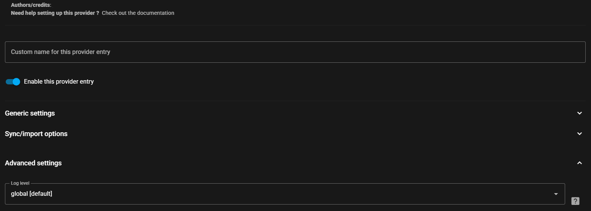

# Music 

**Settings → Music** holds your music sources, and the settings of the library, genres, metadata and audio analysis. The tiles at the top lead to [Library settings](#library-settings), [Genre management](#genre-management), [Metadata](/settings/metadata-provider-settings/) and [Audio analysis](#audio-analysis). They are for administrators, so a user sees only the list of music sources.

## Music sources

The **Music sources** list holds every [music source](/music-providers/) that is set up, including the live sources: plugins that let another app play into Music Assistant, such as [Spotify Connect](/plugins/spotify-connect/) and the [AirPlay Receiver](/plugins/airplay-receiver/). A source that needs attention is listed first.

The labels on a source say what it offers: **Library**, **Radio**, **Podcasts**, **Audiobooks** or **Live sources**. They come from what each source declares, and some sources, such as [Local files](/music-providers/local-files/), show no label. When the list holds more than one kind, chips above it filter on these labels, and **All** shows every source again. A long list also has a search box.

An administrator sees every source in one list. A user sees the sources they own under **Your sources**, and every other source they can use under **Shared with you**. See [Owner and sharing](#owner-and-sharing).

**Add a music source** opens the [Marketplace](/settings/marketplace/) on its music sources.

## A source's own page

All [Music Sources](/music-providers/) have settings which can be configured. Selecting a source in the **Music sources** list opens its own page, which will look similar to the following. See the specific music source pages for source specific settings.

- <b>Header.</b> The source's name, its status and a short description. The pencil next to the name sets a custom name. The ⋮ menu holds the same actions as the ⋮ menu in the list of sources, such as disabling or removing the source. Below the description are buttons for **Reconfigure** (sources that have a setup flow), **Documentation**, which opens the source's page in this documentation, and **Known issues**
- <b>Access.</b> Who owns the source and who else may use it. See [Owner and sharing](#owner-and-sharing) below
- <b>Players.</b> Only for sources that also bring players to Music Assistant. Shows how many there are and opens them in the players list
- <b>Storage location.</b> Only for sources that read files, such as [Local files](/music-providers/local-files/). Shows where the files are read from, and administrators can open the [Storage](/settings/storage/) page from here
- <b>Library sync.</b> **Synchronize now** brings the library up to date with this source straight away, instead of waiting for the next scheduled sync
- <b>Options.</b> All of the settings for the source, in one card and grouped under headings. Some are only shown when the **Show advanced settings** toggle in the card's header is on. The toggle is remembered for your user. Specific help for a setting is often available and is accessed by selecting this icon . The log level can be adjusted for all sources and is one of the advanced settings. (Do not select Verbose unless asked for by a dev as it can have an adverse performance impact)

## Owner and sharing

In the **Music sources** list, an administrator sees who owns each source and who can use it, such as `Shared (no owner) · Everyone, including guests`, or the owner's name followed by who it is shared with. They can change both with **Access** in the source's ⋮ menu. Users see the sources they own under **Your sources**, who they are sharing them with, and can change that with **Sharing** in the same menu. Every other source they can use, shared by someone else or without an owner, is listed under **Shared with you** and cannot be changed there. [Personal and shared music sources](/settings/user-management/#personal-and-shared-music-sources) explains each option.

## Library settings

Which copy of a track plays, and the maintenance of the library.

### Source selection

These settings decide which copy of a track plays when it is available from more than one source. [Which Source Plays](/source-selection/) explains them with examples.

- <b>Which source plays.</b> The options are `Best quality [default]`, `Prefer local` and `Best quality for every track`. With the first two, an album plays all of its tracks from one source, and a playlist or folder plays from the source it comes from. Prefer local plays from your local and self-hosted sources before streaming services
- <b>Upgrade copies below.</b> The options are `Off [default]`, `High-bitrate lossy`, `Lossless` and `Hi-res`. When the copy that would play is below the chosen quality, a better copy of the track plays instead, when the track has one

### Library maintenance

These settings are only visible when the advanced toggle is on.

- <b>Keep remastered versions apart.</b> Off by default. Keeps a track or album that is named as a remaster, such as `Remastered 2009`, apart from the original in the library instead of merging the two. Tracks and albums that were already merged stay merged. Read [Keep remastered versions apart](/source-selection/#keep-remastered-versions-apart) before turning it on
- <b>Reset library database.</b> Selecting this button will erase the [MA library](/usage/#the-library) database. This is a destructive irreversible action! This should only be used if database corruption is confirmed. All library items including playlists stored in the database will be lost and will need to be recreated. A rescan of the music sources will rebuild the database with the information contained on those providers. Do not use this routinely. For problems with individual items use the REMOVE FROM LIBRARY menu option

## Genre management

This page provides tools for maintaining the genre database. The [Genres](/genres/#managing-genres) page describes these tools and the rest of the genre system in full.

- <b>Genre Library Administration.</b> Displays statistics about the genres in the library. Genres can be excluded from use via the ⋮ menu
- <b>Restore Missing Defaults.</b> Checks for any built-in default genres that are missing from your library and restores them. This does not affect any existing genres or their mappings
- <b>Full Restore (Reset All).</b> A destructive operation that completely rebuilds the genre database from defaults. This removes all custom genres and restores the full set of built-in genres

> [!CAUTION]
> Full restore deletes all custom genres, aliases, and media mappings. This action requires a two-step confirmation to prevent accidental data loss.

## Audio analysis

This page lists what is set up to analyse your audio, such as [Loudness Analysis](/audio-analysis/loudness-analysis/), [Smart Fades](/audio-analysis/smart-fades/), [Sonic Analysis](/audio-analysis/sonic-analysis/) and [AcoustID Lookup](/audio-analysis/acoustid/). **Add audio analysis** opens the [Marketplace](/settings/marketplace/) on its audio analysis.

### Analysis status

**Audio Analysis Coverage**, at the top of the page, shows the progress of each one. The stale number is the number of tracks that need to be re-analysed due to a version change. **Audio Analysis Failures** shows the tracks that failed and the reason for the failure. Each line can be individually deleted to unblock the file and allow it to be rescanned, and **Clear all** clears every failure.

The page has two settings:

- <b>Background analysis concurrency.</b> Maximum number of tracks analysed concurrently during the nightly background scan. Starts at 1, or 2 on a server with 4 or more CPU cores, and should only be increased on more powerful systems
- <b>Smart Fades Log level.</b> Specific log level for the Smart Fades mixer and analyzer. Setting is only visible when the advanced toggle is on
