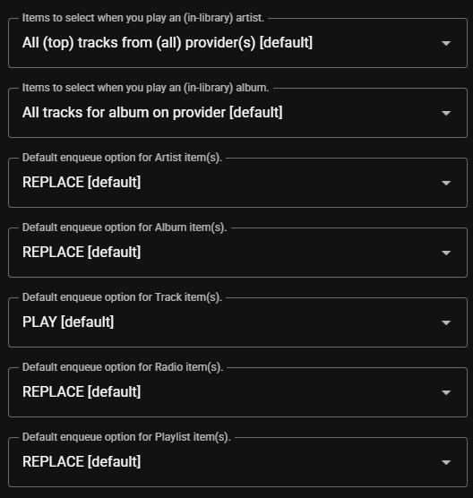
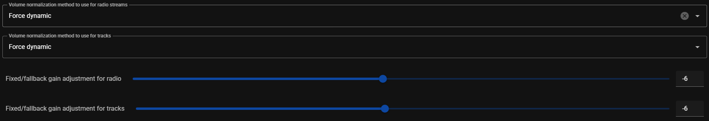

# Playback 

**Settings → Players → Playback** holds the defaults every player follows. What clicking or playing an item does is set on [Tap & play](/settings/tap-and-play/). Smart shuffle, autoplay, crossfade and volume normalization are set on a global level here and can be overridden for each player in its own [playback settings](/usage/#the-queue). Only administrators see this page.

Some settings are only shown when the **Show advanced settings** toggle in the header of the **Options** card is on, and the toggle is remembered for your user.

## General

- <b>Volume step size (0 = automatic).</b> Defaults to zero which enables an adaptive mode where the step size is smaller at the ends of the range. When set, this determines how much the volume change when an up or down command is received (e.g. mouse wheel click, slider tap, HA action)

## Smart shuffle

Smart Shuffle enhances standard shuffle behavior by intelligently reducing repetition. Instead of selecting tracks purely at random, songs and artists that have been played recently are deprioritized, resulting in a more evenly distributed listening experience and reducing the likelihood of the same tracks being repeated when playlists are replayed. Smart Shuffle is always applied when playing a dynamic playlist, regardless of this setting.

- <b>Smart shuffle.</b> `Disabled [default]` or `Enabled`. When enabled, the shuffle button uses Smart Shuffle instead of a plain random shuffle
- <b>Avoid replaying the same song heard within.</b> How long a song that has already been heard is pushed toward the back of the queue. From `Off` to `4 weeks`, default `1 week`. Setting is only visible when the advanced toggle is on
- <b>Avoid replaying the same artist heard within.</b> The same for artists. From `Off` to `2 hours`, default `30 minutes`. Setting is only visible when the advanced toggle is on
- <b>Minimum gap before repeating a deliberately-duplicated song.</b> When the same song is added to the queue more than once on purpose, this is the shortest time before it may play again. From `Off` to `24 hours`, default `3 hours`. Setting is only visible when the advanced toggle is on

**Optimize order for Smart Fades** is an optional Smart Shuffle setting, shown when the advanced toggle is on. When Smart crossfade is active, Music Assistant uses existing Smart Fades analysis to arrange upcoming tracks so Smart Fades has a better chance of creating a smooth transition between consecutive tracks. It considers tempo, musical key and how the energy changes from the end of one track to the start of the next. Songs and artists played recently are still deprioritized according to the Smart Shuffle settings. No new analysis is started for this, and tracks without analysis are neither preferred nor penalized. Smart Fades still decides how the actual transition is mixed when the tracks play.

## Autoplay

A setting is available to enable Autoplay by default on all queues. Each queue can still turn it on or off from the player controls, and Autoplay is always active when a dynamic playlist is playing. The **Autoplay source** setting has five options as follows:
- <b>Automatic — similar tracks, falling back to your library (default).</b> New tracks similar to what was recently played are requested from the music providers. If no provider is able to supply similar-track recommendations (for example, when only local files are used), an endless mix drawn from the library is used instead, so playback will not stop

- <b>Similar to what you played.</b> Tracks that resemble the most recently played items in the queue are fetched from the connected music providers and appended to the queue. This mode relies on a provider that offers similar-track recommendations; if none is available, no tracks are added

- <b>Infinite mix from your library.</b> Tracks are selected from the local library, with preference given to those that have been played the least. The selection is biased towards the genres of the items that were played most recently; when too few matching tracks are found, the mix is topped up with random tracks from across the whole library.

- <b>Tracks from a playlist.</b> Tracks are taken from the playlist chosen in the **Autoplay playlist** box, which appears when this option is selected

- <b>Similar artists.</b> When the queue runs out, a similar artist of the last track's artist is added, one with no track in the queue yet. It is queued the same way as playing that artist. With an album order in [<b>Order to play an artist in</b>](/settings/tap-and-play/#which-tracks-play), all its albums play whole, one after the other, if shuffle is off. Autoplay does not change the queue's shuffle. If no similar artist is left, no tracks are added. This option needs a music provider that supplies similar artists

## Crossfade

Crossfade can be enabled or disabled by default on all queues via a setting here and also can be turned on and off via the button at the top of the [Now Playing view](/ui/#now-playing-view). Which crossfade mode will be enabled can be set here on a global level but can be overridden on a per player basis as well. [Smart crossfade](/audio-analysis/smart-fades/) is the default. It needs the Smart Fades analysis provider and an **Audio buffer size** of `Balanced` or larger; without them the option is greyed out and Standard crossfade is used. Smart Fades automatically analyzes each track’s tempo and beats to create seamless, musically aligned transitions between songs. It adjusts BPM, aligns downbeats, and applies EQ-based mixing for smoother fades—falling back to standard crossfade if analysis fails. Standard crossfade smoothly overlaps the end of one song with the start of the next using a simple volume fade. The **Standard crossfade duration (seconds)** (default 8) appears when Standard crossfade is selected, and this is the only place it can be set.

- <b>Allow crossfade between tracks from the same album.</b> Not enabled by default as it may not be desirable particularly for live albums. Setting is only visible when the advanced toggle is on

## Volume normalization

<b>Volume normalization.</b> [Volume Normalization](/faq/how-to/#use-volume-normalization-how-does-it-work) is enabled by default and works to eliminate volume differences between media items and sources. It can be overridden on an [individual queue basis](/usage/#the-queue).

How it is done is set with **Volume normalization method for tracks** and **Volume normalization method for radio streams**, which you set independently. Both are only visible when the advanced toggle is on.

The best result comes from a loudness measurement of the audio. Tracks tagged with ReplayGain or R128 loudness values supply one directly, and Music Assistant uses those in preference to measuring anything itself. Everything else it measures on its own: your local library automatically in a nightly background scan, and anything played, including streaming services, while it plays, so those are covered from the second play onwards. The options differ mainly in what happens before a value exists:

- Fallback dynamic (default) — use the measurement when there is one, otherwise adjust loudness on the fly. Always evens things out; the on-the-fly path is slightly less precise and can be heard as [the volume drifting during a track](/faq/troubleshooting/#the-volume-rises-and-falls-during-a-track) the first time it is played
- Fallback fixed gain — use the measurement when there is one, otherwise apply the fixed adjustment below
- Measured loudness — only adjust when a measurement exists. Anything not yet analysed plays at its original loudness
- Dynamic — always adjust on the fly, ignoring measurements
- Fixed gain — never analyse; apply the same fixed adjustment to everything
- Disabled — leave loudness untouched

Once a measurement exists it is used, whichever of the two fallback options is selected. Two other things are worth knowing: live radio is rarely measured, so the radio setting in practice runs on whichever fallback you choose, and volume normalization also has to be switched on for the player itself. These settings control how it's done, not whether. How the value is chosen, and when album gain is used instead of track gain, is covered on the [Technical Information](/faq/tech-info/#volume-normalization) page.

<b>Fixed/fallback gain for tracks / radio streams (dB).</b>

How much to raise or lower the volume, in dB, whenever the fixed-gain path is used. That's either the Fixed gain method, or Fallback fixed gain when no measurement is available. Negative values make things quieter. The range is −20 to +10 dB and the default is −6. Other methods ignore it. Again, separate values exist for tracks and radio. Both are only visible when the advanced toggle is on.

- <b>Target level for volume normalization (LUFS).</b> The loudness, in LUFS, that volume normalization aims for. The default is -14 LUFS and a value between -23 and -12 LUFS is recommended. See [Technical Information](/faq/tech-info/#volume-normalization). Setting is only visible when the advanced toggle is on

## Playback

- <b>Stop a paused player after (seconds).</b> How long a player may stay paused before Music Assistant stops it to free the audio it holds. It starts at 30 seconds. Once stopped, the player shows as idle, and pressing play still continues where you paused. Not every player can stay paused for long. Setting is only visible when the advanced toggle is on
- <b>Audio buffer size.</b> Controls how much audio is buffered in memory. A larger buffer improves playback stability and seeking but uses more memory. The options are `Maximum [default]`, `Minimal` and `Balanced`. The options are filtered depending upon system RAM. Minimal (60s buffer) is always available, Balanced (300s) requires a nominal 4 GB of RAM, and Maximum (1200s) requires a nominal 8 GB of RAM. If total memory can't be determined then all three presets are offered although the default in that case is, conservatively, Minimal.

## Announcements

- <b>Announcement text-to-speech engine.</b> Which engine is used to generate [announcements](/integration/announcements/) sent from within Music Assistant. The engines on offer come from your plugins, such as the [Home Assistant Plugin](/ha-plugin/#ai-and-text-to-speech-engines). Unless you pick one, it follows the default text-to-speech engine from [**Settings → AI**](/settings/ai/)
