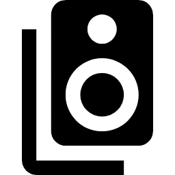
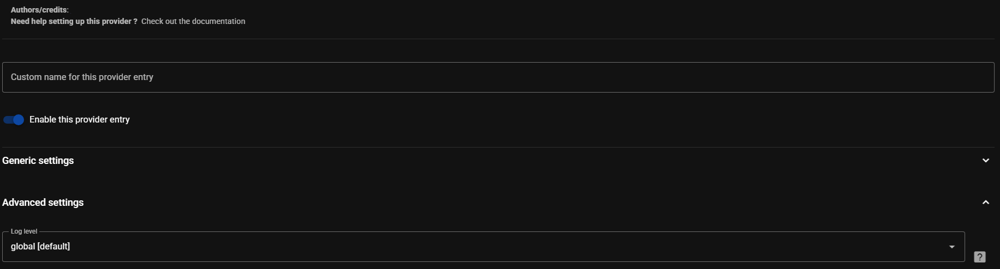

# Player Support Settings 

Everything under **Settings → Players → Player support** has settings which can be configured. Selecting one opens its page, which will look similar to the following. The **Documentation** button below the description opens its page in this documentation, **Known issues** lists the reported problems and **Get help** shows where to ask questions, and the **Players** row shows how many players it brings and opens them in the players list. Specific help for a setting or configurable field is often available and is accessed by selecting this icon . Each one can be given a custom name with the pencil next to its name, and disabled from the ⋮ menu if necessary. All the settings are in one **Options** card, and some only show when the **Show advanced settings** toggle in its header is on. The log level can be adjusted for each one and is one of the advanced settings. (Do not select Verbose unless asked for by a dev as it can have an adverse performance impact). See the page of each player support for its own settings (many have none) and the [Individual Player Settings](/settings/individual-player/) page.

